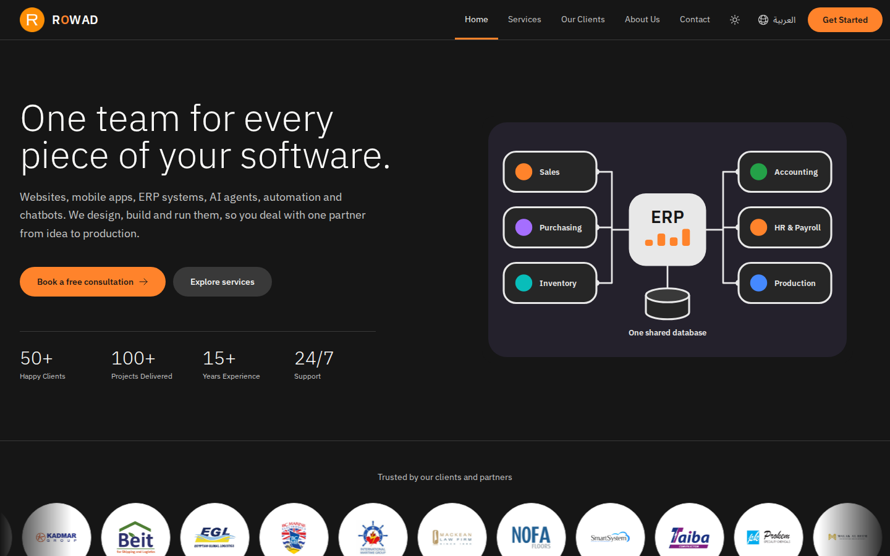
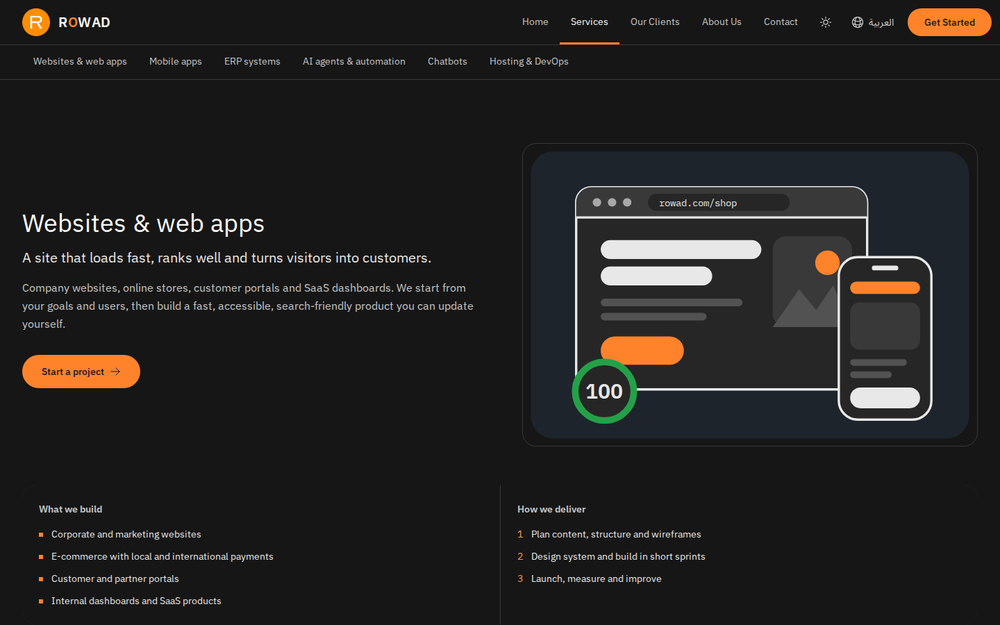
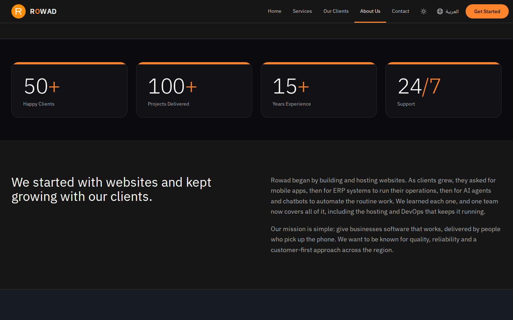
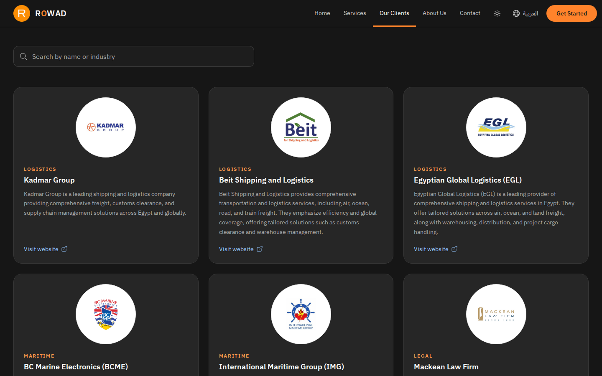
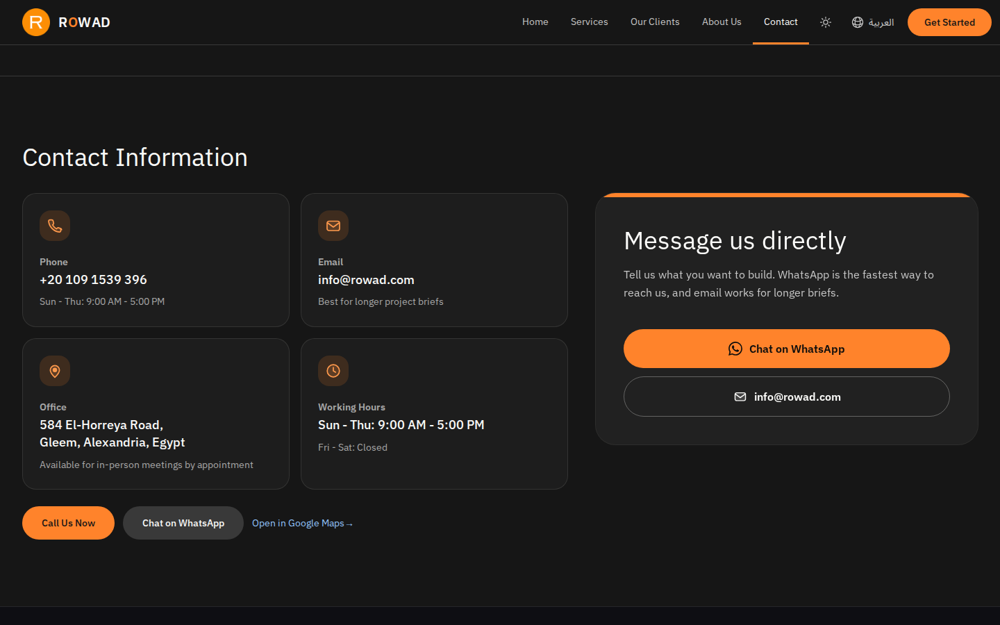
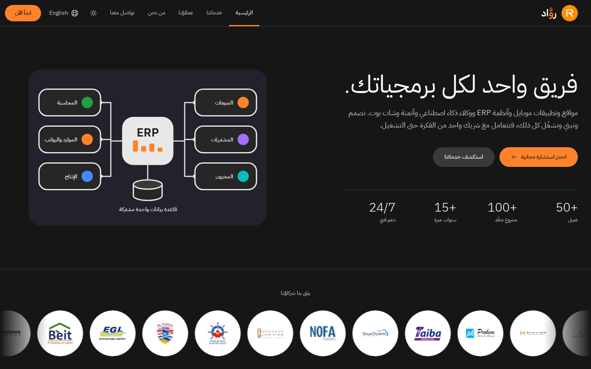
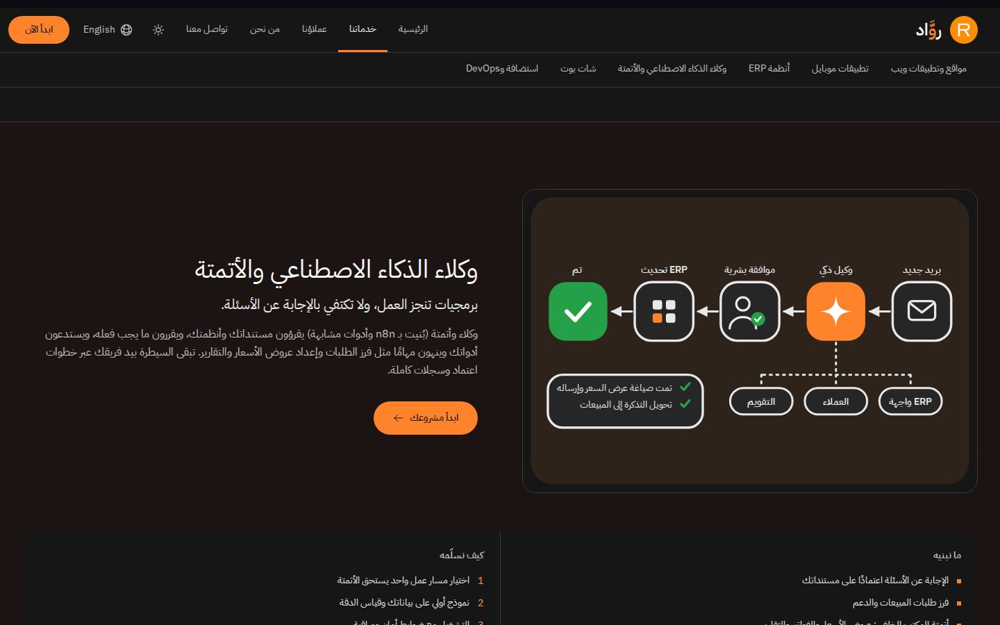

# Rowad

**Rowad for Software Development** is a software company in Alexandria, Egypt. We design, build and
run custom software for businesses, from idea to production.

Website: https://rowad.com (English and Arabic)

## What we do

- **Websites and web apps**
- **Mobile apps** for iOS and Android
- **ERP systems**: implementation, migration and custom modules
- **AI agents and automation**, with tools like n8n
- **Chatbots** on WhatsApp and the web, in Arabic and English
- **Hosting and DevOps**: managed hosting, CI/CD, backups and monitoring

## About us

Rowad began by building and hosting websites. As clients grew, they asked for mobile apps, then for
ERP systems to run their operations, then for AI agents and automation to take over routine work.
We learned each one, and one team now covers all of it, including the hosting and DevOps that keeps
it running.

Our mission is simple: give businesses software that works, delivered by people who pick up the
phone. We want to be known for quality, reliability and a customer-first approach across the region.

## How we work

1. **Discover**: we listen, map the problem and agree the plan.
2. **Design**: you click through a prototype before we write code.
3. **Build**: short sprints, with a demo every two weeks.
4. **Launch**: we go live, train your team and stay on call.

## This repository

The code of the company website: a static Next.js site in English and Arabic (right to left),
deployed to our own hosting on every merge into `dev`.

## Screenshots

| Home | Services |
| --- | --- |
|  |  |

| About | Clients |
| --- | --- |
|  |  |

### العربية (Arabic)

| الرئيسية | الخدمات |
| --- | --- |
|  |  |
